# k8s-guardrails-webhook

[](https://github.com/santoshmyakala/k8s-guardrails-webhook/actions/workflows/ci.yml)


A Kubernetes **validating admission webhook**, written in Go, that enforces platform guardrails before a workload reaches the cluster:
- **Trusted images:** from allowed registries only, and **pinned by digest**, so what was scanned and signed is what runs.
- **Cost allocation:** every pod carries `team` and `cost-center` labels.
- **Right-sizing:** CPU and memory requests and a memory limit on every container.
- **Least privilege:** `runAsNonRoot`, no privileged containers, `allowPrivilegeEscalation: false`, no host namespaces.

It checks Pods and every workload that templates them: Deployments, StatefulSets, DaemonSets, ReplicaSets, Jobs and CronJobs. `kubectl apply` fails immediately with **every** reason, instead of a ReplicaSet failing silently later:

```console
$ kubectl apply -f debug.yaml
Error from server (Forbidden): error when creating "debug.yaml": admission webhook "workloads.guardrails.platform"
denied the request: guardrails: Pod "debug" violates 9 rule(s):
[required-labels] metadata.labels: label "team" is required for cost allocation; …
[image-digest] spec.containers[0] (sh): image "busybox:latest" must be pinned by digest (name@sha256:…); …
```

<picture>
  <source media="(prefers-color-scheme: dark)" srcset="docs/diagrams/admission-flow-dark.svg">
  
</picture>

<sub>Animated diagrams generated from <a href="docs/diagrams/diagrams.yaml">docs/diagrams/diagrams.yaml</a> with <a href="https://github.com/santoshmyakala/santoshmyakala/tree/main/tools/archdiagram">archdiagram</a>.</sub>

## Design decisions

| Decision | Why |
|---|---|
| **Fail closed** (`failurePolicy: Fail`) with 2 replicas, a PodDisruptionBudget, `maxUnavailable: 0` and a drain delay on SIGTERM | An unavailable guardrail must not let unchecked workloads in, so the webhook itself must not be a single point of failure. The e2e test scales it to zero and asserts that the API server rejects workloads |
| **Checks controllers *and* Pods** | Denying the Deployment gives the author immediate feedback. Checking Pods covers anything created without a controller |
| **Ratcheting on UPDATE** | A violation the object *already had* is returned as a warning, not a denial. Workloads that predate a rule can still be scaled, relabelled and patched; only changes that *introduce* a violation are denied |
| **Break-glass** annotation on the pod template: `guardrails.platform/break-glass: INC-2041` | Incidents happen. Each use admits the workload with a warning, is logged with the ticket and user, and is counted in `guardrails_break_glass_total`. It is read from the **pod template**, because only template annotations reach the Pods; one on the Deployment alone is ignored |
| **`warn` mode** | Roll out with `enforcement: warn`: kubectl prints the warnings and `guardrails_violations_total{rule,namespace}` shows who to help first. Then switch to `deny` |
| **Memory limits required, CPU limits not** | A memory limit protects the node from an OOM cascade. A CPU limit only throttles a pod that could use idle CPU, which hurts latency for no safety gain |
| **`runAsNonRoot` required even with a non-zero `runAsUser`** | Matches Pod Security *restricted*: `runAsNonRoot` makes the kubelet verify the user at start, so an image change can't silently fall back to root |
| **Registries matched on whole path segments** | `ghcr.io/acme` allows `ghcr.io/acme/app`, but not `ghcr.io/acme-evil/app`. Short names are expanded as the runtime does: `nginx` is `docker.io/library/nginx` |
| **Two exemption layers** | Exempt namespaces are excluded in the webhook configuration (the API server never calls) **and** in the policy. A test fails if the two lists drift apart. Exempting its own namespace prevents a deadlock where the webhook would have to admit itself |
| **Undecodable objects are denied** | For a kind it claims to handle, the webhook fails closed rather than guess |

## Running it securely

- **TLS 1.3 only.** The certificate is issued and rotated by **cert-manager**, which also injects the CA into the `ValidatingWebhookConfiguration`. The webhook **reloads the rotated files without a restart**; a half-written rotation keeps the previous certificate.
- **No Kubernetes API access:** the service account has no roles and no mounted token.
- **Locked-down pod:** distroless static image, UID 65532, read-only root filesystem, all capabilities dropped, seccomp `RuntimeDefault`, and a namespace enforcing Pod Security *restricted*.
- **No egress:** a NetworkPolicy denies all outbound traffic. Ingress is limited to 8443 (admission) and 9090 from the `monitoring` namespace (metrics).
- **Self-compliant:** a unit test checks that the webhook's own Deployment satisfies the policy it ships.

## Policy

[`deploy/base/policy.yaml`](deploy/base/policy.yaml); unknown fields are rejected, so a typo cannot silently switch a rule off:

```yaml
enforcement: deny            # or warn
exemptNamespaces: [kube-system, kube-public, kube-node-lease, guardrails-system, cert-manager]
allowedRegistries: [ghcr.io/santoshmyakala, registry.k8s.io]
requireDigest: true
requiredLabels: [team, cost-center]
requireResources: true
requireNonRoot: true
allowBreakGlass: true
```

The policy is a kustomize-generated ConfigMap, so a change rolls the webhook.

## Observability

| Metric | Labels |
|---|---|
| `guardrails_admission_requests_total` | `kind`, `operation`, `decision`: allowed, denied, warned, grandfathered, exempt, break-glass, error |
| `guardrails_violations_total` | `rule`, `namespace` |
| `guardrails_break_glass_total` | `namespace` |
| `guardrails_admission_duration_seconds` | histogram |

Logs are JSON (`log/slog`). Every denial and break-glass entry carries the kind, namespace, name, user, request UID and dry-run flag.

## Tests

```bash
go test -race ./...          # unit + HTTP tests
test/e2e/run.sh              # against a kind cluster (see ci.yml for the setup)
```

**Unit and HTTP tests (21 functions, 37 cases; 84–97% coverage of the internal packages):**
- every rule, its look-alikes and init containers;
- image normalisation and policy parsing mistakes;
- full AdmissionReview round trips over HTTP:
  - allow, deny with every reason, warn mode;
  - break-glass on the template versus on the Deployment;
  - CronJob field paths, ratcheting, exempt namespaces, DELETE, kinds without pods;
  - undecodable objects, bad methods, bad media types and oversized bodies;
- certificate rotation, and a broken rotation;
- the shipped manifests against their own policy.

**End-to-end against a real API server** ([`test/e2e/run.sh`](test/e2e/run.sh), 9 checks in kind). CI installs cert-manager and deploys the webhook with kustomize, then verifies through server-side dry runs:
- a compliant Deployment is admitted;
- a non-compliant Pod is denied with every reason;
- a missing label, a tag-pinned image and a look-alike registry are each denied;
- break-glass admits with a warning;
- exempt namespaces are skipped;
- decisions show up in the metrics;
- **with the webhook scaled to zero, the API server rejects workloads.**

## Delivered by GitHub Actions

<picture>
  <source media="(prefers-color-scheme: dark)" srcset="docs/diagrams/github-actions-dark.svg">
  
</picture>

- [`ci.yml`](.github/workflows/ci.yml): gofmt, vet, staticcheck, race tests with coverage, govulncheck, kustomize + kubeconform, image build + Trivy, kind e2e, gitleaks.
- [`release.yml`](.github/workflows/release.yml) runs **only after `ci` succeeds** on `main` or a `v*` tag, from exactly the commit `ci` tested. It publishes `linux/amd64` + `linux/arm64` to GHCR with SBOM and provenance attestations and **signs by digest with cosign (keyless)**:

  ```bash
  cosign verify ghcr.io/santoshmyakala/k8s-guardrails-webhook@sha256:<digest> \
    --certificate-identity-regexp '^https://github.com/santoshmyakala/k8s-guardrails-webhook/' \
    --certificate-oidc-issuer https://token.actions.githubusercontent.com
  ```

## Install

Prerequisite: cert-manager. Pin the released digest in an overlay, then:

```bash
kubectl apply -k deploy/base
```

## Licence

MIT
